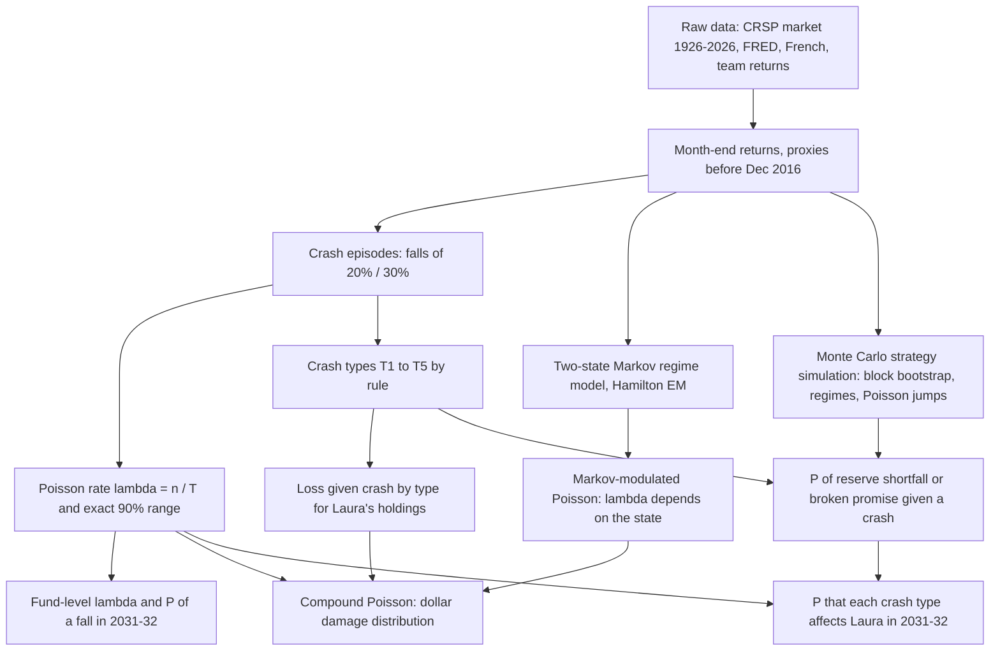

# How the models connect

This repository sits beside two earlier ones: **Markov-Model** (regime labels, transition matrix, stationary mix) and **Monte-Carlo-Simulations-** (block-bootstrap simulation of the ETFs). The Poisson model borrows an idea from each and adds one more layer.

## What each model contributes

| Model | Question it answers | Where it enters | Output used downstream |
|---|---|---|---|
| Poisson process | How often does a crash start, and how many in a window? | Counts crashes in the long US series, then in each fund | λ, P(≥1), P(N = k), exact 90% ranges |
| Markov chain (two-state Hamilton) | Is the market calm or turbulent now, and how long does a state last? | Fitted to the same monthly returns | Transition matrix, stationary mix, today's state; makes λ depend on the state |
| Markov-modulated Poisson | How do crash odds change given the current state? | Combines the two rows above | Clustering: 2-year odds from calm today against just after a crash starts |
| Compound Poisson | How many dollars does Laura lose, not just how many crashes? | Poisson count × loss per crash from her actual holdings | E[S], Var[S], exceedance curve, VaR, CVaR |
| Monte Carlo (block bootstrap) | Given a crash, does each strategy still fund the reserve and keep the 2031 promise? | `strategy_sim.py`: 72 monthly steps (2027 to 2033) on 10,000 paths drawn from 274 months of history (2004 to 2026), four cases (H historical, S stressed, C current yields, J jump-diffusion) | P(shortfall | crash), P(promise broken | crash) |
| Probability product | Which crash type can actually hurt Laura? | P(type occurs) × P(harm | type) | Figure 6 and Table 8.14b of the Research Pack |

## Links to the earlier repositories

- **Monte-Carlo-Simulations-:** supplies the team's actual daily fund returns (`data/raw/team/returns_used.csv`, Nov 2016 to Oct 2026), and the same block-bootstrap idea (resampling blocks of months so that clustering of returns is kept). Here the bootstrap is 6-month blocks over 2004–2026. Its Markov statistics file is a different object from the regime model fitted here.
- **Markov-Model:** the same idea of regimes, a transition matrix and a stationary mix. Here the regimes are fitted by the Hamilton (1989) expectation-maximisation algorithm on the whole 1926–2026 market series instead of per-ticker regime labels, so figures from the two repositories are not directly comparable.
- **Not shared:** the Metropolis–Hastings audit in Monte-Carlo-Simulations- is not used here (one of its checks was failing when last seen, and it is disclosed in the limits).

## Where the layers can disagree, and what to do

| Disagreement | Why it happens | How to read it |
|---|---|---|
| Plain Poisson 18.1% against Markov 12.5% for 2027–28 | Today is probably calm and the chain remembers it for a while | Both are right for different questions; by 2031–32 they converge |
| Fund-level λ above the market λ for VXUS and EQAL | They are more volatile than the US total market and have shorter histories | Use the market λ for timing and the fund λ for how much each sleeve is exposed |
| P(type affects Laura) tiny although P(crash) is 18% | The strategies hold a cushion and bonds gain in most types | The product is small by design; the inflation/rate shock is the exception |
