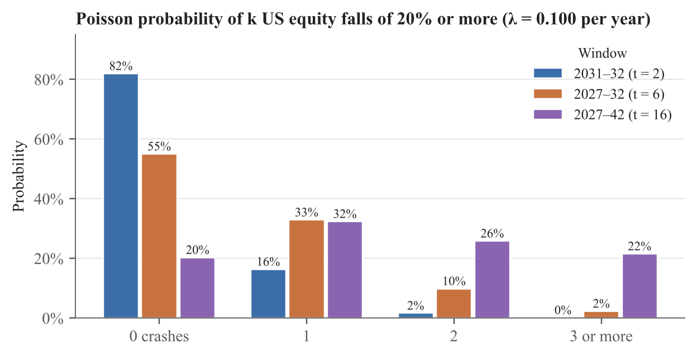
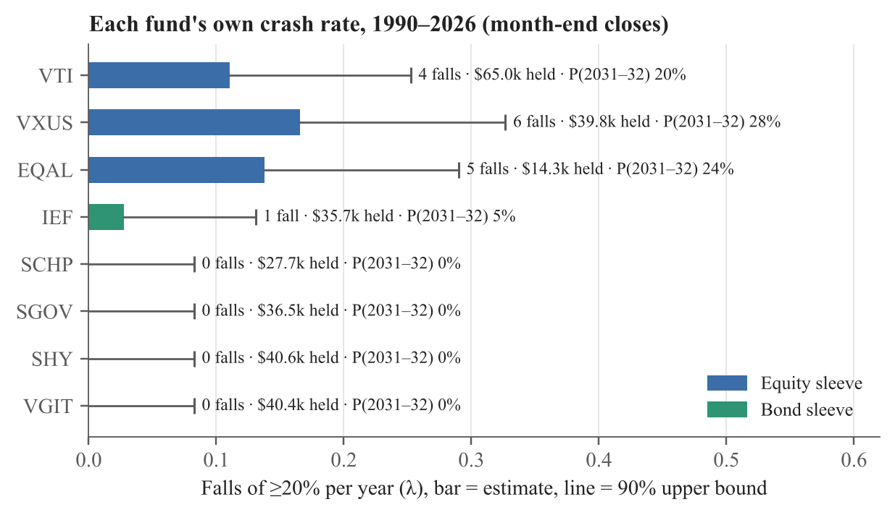
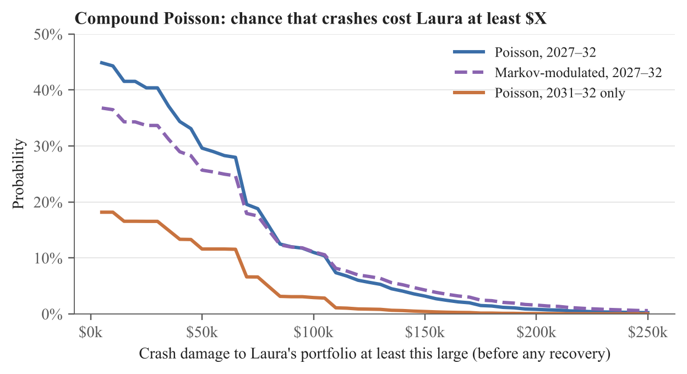
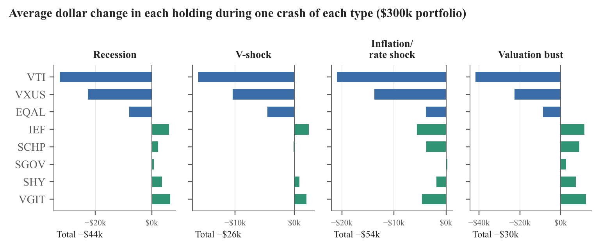
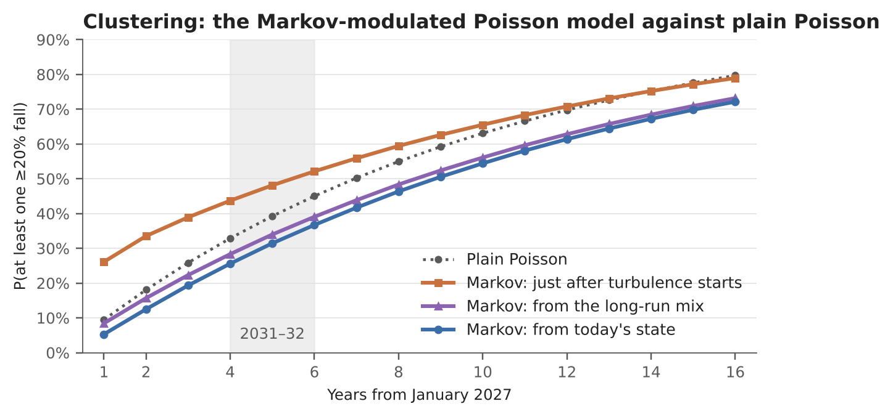
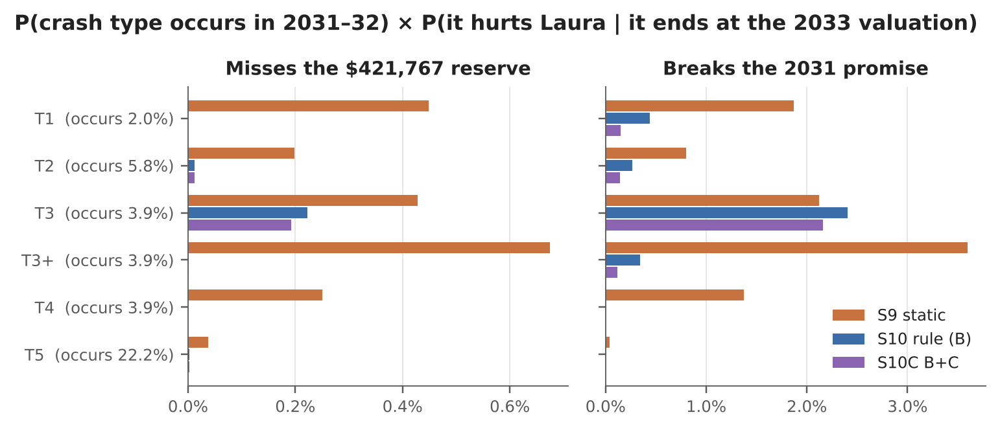

# Poisson crash model for Laura Gao: final report

Team Parallax · Wharton Global High School Investment Competition 2026–27 · companion to Research Pack Section 8.
Every number below is generated by `src/make_report.py` from `results/*.json`, so the text cannot drift from the code.
Other documents: [Interconnections](INTERCONNECTIONS.md) · [Data catalogue](DATA.md) · [Sensitivity](SENSITIVITY.md).

> **AI-use note.** Written with AI assistance (Anthropic's Claude) as study material. Anything used in the Final Report must be in the team's own words, with AI use cited in APA style.

## The answer in one table

| Question | Answer |
|---|---|
| How often do US equities fall 20% or more? | 10 falls in 100.3 years: λ = 0.0997 a year, one every 10.0 years (90% range 0.054–0.169) |
| Chance of at least one in the critical years 2031–32 | **18.1%** (90% range 10.3%–28.7%) |
| Chance of at least one during 2027–32 | 45.0% (plain Poisson) · 36.7% (Markov-modulated, from today's state) |
| Cost to Laura of one crash ($300k portfolio) | about $39,882 (-13.3%) before any recovery |
| Expected crash damage, 2027–32 | $33,676; P(≥ $50k) = 29.6%; 99% VaR $190,419 |
| Is Poisson a fair description of the timing? | Yes, not rejected: variance/mean = 0.91, p = 0.73 |
| Independent checks | 199 of 199 pass (`python src/verify.py`) |

## 1. The inputs (Case Study only)

| Item | Value |
|---|---|
| Invested | $300,000 at the start of 2027; $150,000 at the start of 2028 |
| Payments | 10 × $50,000, start of 2033 to start of 2042 (annuity-due) |
| Reserve needed in 2033 | $421,767 at 4% (IPS); $439,305 at 3% (stress) |
| Equity share as built | 39.7% |
| Cash row | $6,319.55 (modelled as SGOV) |

| Holding | Cost basis | Weight |
|---|---|---|
| VTI | $64,962.10 | 21.7% |
| VXUS | $39,786.00 | 13.3% |
| EQAL | $14,303.35 | 4.8% |
| IEF | $35,736.00 | 11.9% |
| SCHP | $27,698.00 | 9.2% |
| SGOV | $30,159.00 | 12.2% |
| SHY | $40,590.00 | 13.5% |
| VGIT | $40,446.00 | 13.5% |

## 2. Defining and counting a crash

A crash is a fall of 20% or more (also 30%) from a previous peak, measured on month-end closes. One crash runs from the peak until the old peak is regained, so a long bear market counts once. The ten falls in the CRSP US total-market series, with the type given by the classification rule (first rule that fits: inflation/rate shock, then V-shock, then valuation bust, then recession, else other):

| Peak | Trough | Recovered | Depth | Type | Δ10-yr yield | CPI at trough | CAPE at peak |
|---|---|---|---|---|---|---|---|
| 1929-08 | 1932-06 | 1945-01 | -84% | T4 Valuation bust | +0.11 pts | -9.9% | 31.5 |
| 1946-05 | 1947-05 | 1949-12 | -24% | T3 Inflation / rate shock | +0.10 pts | 18.6% | 16.0 |
| 1961-12 | 1962-06 | 1963-04 | -23% | T5 Other | -0.15 pts | 1.2% | 22.0 |
| 1968-11 | 1970-06 | 1972-01 | -34% | T3 Inflation / rate shock | +2.14 pts | 6.0% | 22.2 |
| 1972-12 | 1974-09 | 1976-12 | -47% | T3 Inflation / rate shock | +1.68 pts | 11.9% | 18.6 |
| 1987-08 | 1987-11 | 1989-05 | -30% | T2 Exogenous V-shock | +0.10 pts | 4.5% | 18.3 |
| 2000-08 | 2002-09 | 2006-09 | -45% | T4 Valuation bust | -1.96 pts | 1.5% | 42.9 |
| 2007-10 | 2009-02 | 2012-02 | -50% | T1 Recession bear | -1.66 pts | 0.0% | 27.3 |
| 2020-01 | 2020-03 | 2020-07 | -20% | T2 Exogenous V-shock | -0.89 pts | 1.5% | 31.0 |
| 2021-12 | 2022-09 | 2023-12 | -25% | T3 Inflation / rate shock | +2.05 pts | 8.2% | 38.3 |

## 3. Figure 1: the Poisson law over three windows

P(N = k) = e^(−λt)(λt)^k / k!, so P(at least one) = 1 − e^(−λt). With λ = 0.0997: for 2031–32, λt = 0.1993 and P(≥1) = 1 − e^(−0.1993) = 18.1%. The 90% range is the exact Garwood (1936) chi-square interval, χ²₀.₀₅(2n)/2T to χ²₀.₉₅(2n+2)/2T.

| Window | P(≥1 fall of 20%+) | 90% range | P(≥1 fall of 30%+) |
|---|---|---|---|
| 2027 (first year) | 9.5% | 5.3% – 15.6% | 4.9% |
| 2031-32 (critical years) | 18.1% | 10.3% – 28.7% | 9.5% |
| 2027-32 (build-up) | 45.0% | 27.7% – 63.7% | 25.8% |
| 2027-42 (whole plan) | 79.7% | 57.9% – 93.3% | 54.9% |

| Window | λt | P(0) | P(1) | P(2) | P(3+) |
|---|---|---|---|---|---|
| 2031–32 | 0.199 | 82% | 16% | 2% | 0% |
| 2027–32 | 0.598 | 55% | 33% | 10% | 2% |
| 2027–42 | 1.595 | 20% | 32% | 26% | 22% |

## 4. Figure 2: each fund's own crash rate

The same counting applied to each fund's own month-end history (1990–2026). A fund with no falls still has a non-zero 90% upper bound, because zero events in 36.2 years cannot rule out a modest rate.

| Fund | Held | Weight | Falls ≥20% | λ | λ 90% upper | P(2031–32) | P(2027–32) | Falls ≥30% | Worst drawdown |
|---|---|---|---|---|---|---|---|---|---|
| VTI | $64,962 | 21.7% | 4 | 0.110 | 0.253 | 20% | 48% | 2 | -50% |
| VXUS | $39,786 | 13.3% | 6 | 0.166 | 0.327 | 28% | 63% | 2 | -57% |
| EQAL | $14,303 | 4.8% | 5 | 0.138 | 0.290 | 24% | 56% | 2 | -56% |
| IEF | $35,736 | 11.9% | 1 | 0.028 | 0.131 | 5% | 15% | 0 | -23% |
| SCHP | $27,698 | 9.2% | 0 | 0.000 | 0.083 | 0% | 0% | 0 | -15% |
| SGOV | $36,479 | 12.2% | 0 | 0.000 | 0.083 | 0% | 0% | 0 | -0% |
| SHY | $40,590 | 13.5% | 0 | 0.000 | 0.083 | 0% | 0% | 0 | -5% |
| VGIT | $40,446 | 13.5% | 0 | 0.000 | 0.083 | 0% | 0% | 0 | -15% |

## 5. Figure 3: what crashes cost Laura (compound Poisson)

Each simulated crash is given a type (in historical proportion), a depth (drawn from that type's history) and each fund's response in the matching episode. Her dollar loss is the exposure ($300k in 2027, $450k from 2028) times the weighted fall of her funds. Total damage S is the sum over N ~ Poisson(λt) crashes, so E[S] = λt·E[L] and Var[S] = λt·E[L²].

| Window | λt | E[S] | Std dev | P(≥$50k) | P(≥$100k) | 95% VaR | 99% VaR | 99% CVaR |
|---|---|---|---|---|---|---|---|---|
| 2027 only | 0.100 | $3,958 | $13,756 | 3.1% | 0.1% | $43,992 | $71,219 | $77,505 |
| 2031-32 | 0.199 | $12,038 | $29,338 | 11.6% | 2.9% | $77,875 | $115,523 | $150,316 |
| 2027-32 | 0.598 | $33,676 | $48,136 | 29.6% | 11.0% | $133,126 | $190,419 | $225,466 |

## 6. Figure 4: dollars lost by fund and crash type

| Type | Share of crashes | Mean loss | Return | VTI | VXUS | EQAL | IEF | SCHP | SGOV | SHY | VGIT |
|---|---|---|---|---|---|---|---|---|---|---|---|
| T1 Recession bear | 10% | $43,992 | -14.7% | $32,684 | $22,709 | $7,949 | −$6,193 | −$2,282 | −$782 | −$3,575 | −$6,517 |
| T2 Exogenous V-shock | 30% | $25,962 | -8.7% | $16,250 | $10,438 | $4,554 | −$2,428 | $153 | −$84 | −$865 | −$2,055 |
| T3 Inflation / rate shock | 40% | $54,220 | -18.1% | $20,958 | $13,773 | $3,864 | $5,593 | $3,815 | −$253 | $1,841 | $4,630 |
| T4 Valuation bust | 20% | $29,986 | -10.0% | $41,799 | $22,625 | $8,631 | −$11,695 | −$9,072 | −$2,614 | −$7,303 | −$12,383 |

Losses are positive and gains negative. In every type except the inflation/rate shock the bond sleeve gains; in 2022 it lost as well.

## 7. Figure 5: clustering with a Markov chain

A two-state Hamilton (1989) model, fitted by EM, gives a calm and a turbulent state. The Poisson rate depends on the state (a Markov-modulated Poisson process): crashes are still Poisson inside each month, and the chain decides which λ applies. See [Interconnections](INTERCONNECTIONS.md) for how this links to the other models.

| State | Long-run share | Typical stay | λ per year |
|---|---|---|---|
| Calm | 83.4% | 41 months | 0.009 |
| Turbulent | 16.6% | 8 months | 0.556 |

| Years from Jan 2027 | Plain Poisson | From today's state | Long-run mix | Just after turbulence starts |
|---|---|---|---|---|
| 1 | 9.5% | 5.3% | 8.4% | 26.1% |
| 2 | 18.1% | 12.5% | 15.7% | 33.5% |
| 4 | 32.9% | 25.6% | 28.3% | 43.7% |
| 6 | 45.0% | 36.7% | 39.0% | 52.1% |
| 8 | 54.9% | 46.4% | 48.3% | 59.4% |
| 12 | 69.8% | 61.4% | 62.8% | 70.8% |
| 16 | 79.7% | 72.2% | 73.2% | 78.9% |

P(turbulent now) = 1.8%. Caveat: the turbulent state is identified from falling, volatile months, so "crashes happen in turbulent states" is partly true by construction. Treat the clustering message as reliable and the exact calm and turbulent rates as rough.

## 8. Figure 6: which crash type can hurt Laura in 2031–32

P(type affects Laura) = P(type occurs in 2031–32, Poisson) × P(harm | it occurs and ends at the 2033 valuation). Upper bounds, because they assume the worst timing. S9 = static LDCS; S10 = LDCS with the cushion rule; S10C = S10 plus the 2031 lock-in.

| Crash type | P(occurs) | Reserve missed: S9 | S10 | S10C | Promise broken: S9 | S10 | S10C |
|---|---|---|---|---|---|---|---|
| T1 Recession bear | 2.0% | 0.45% | 0.00% | 0.00% | 1.87% | 0.44% | 0.00% |
| T2 Exogenous V-shock | 5.8% | 0.20% | 0.01% | 0.01% | 0.80% | 0.27% | 0.09% |
| T3 Inflation/rate shock | 3.9% | 0.43% | 0.22% | 0.18% | 2.12% | 2.41% | 2.00% |
| T3+ Severe inflation shock | 3.9% | 0.68% | 0.00% | 0.00% | 3.60% | 0.34% | 0.00% |
| T4 Valuation bust | 3.9% | 0.25% | 0.00% | 0.00% | 1.37% | 0.00% | 0.00% |
| T5 Falling-rate shock | 22.2% | 0.04% | 0.00% | 0.00% | 0.04% | 0.00% | 0.00% |

## 9. How it was checked

`python src/verify.py` runs **199 independent checks, 199 passing**. They recompute the numbers a second way (a separate crash counter, Garwood by inverting the Poisson cdf, the Markov recursion month by month) and compare the case arithmetic with the Team Study Pack tables (reserve at 0–6%, 2033 portfolio at 0–8%). `python -m pytest tests -q` runs six unit tests of the mathematics.

## 10. Limits

- Ten falls is a small sample: per-type rates rest on 1–4 events each (see [Sensitivity](SENSITIVITY.md)).
- Proxy data before Dec 2016 (validation correlations 0.94 and above); EQAL's proxy runs about 1.6 points a year hot.
- Damage is measured before recovery, with no taxes or fees. Worst-timing probabilities are upper bounds.
- USD/TWD currency risk is analysed but not simulated.
- The IPS rules do not allow graphics, so these charts are study material, not IPS content.
