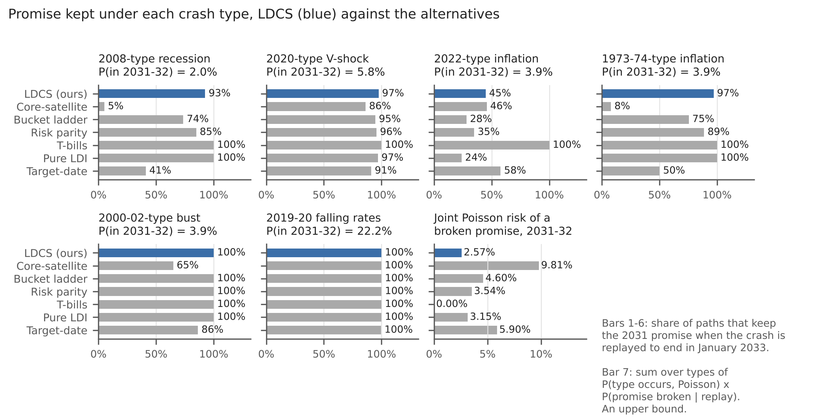
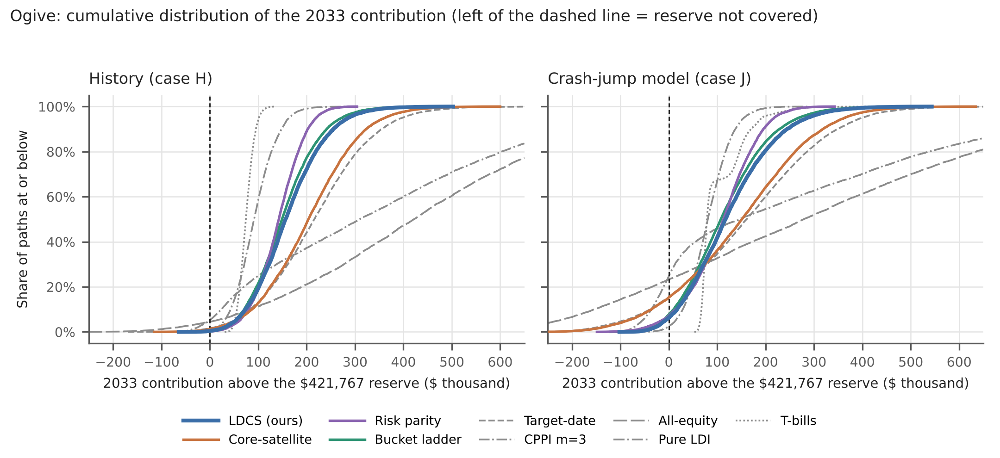
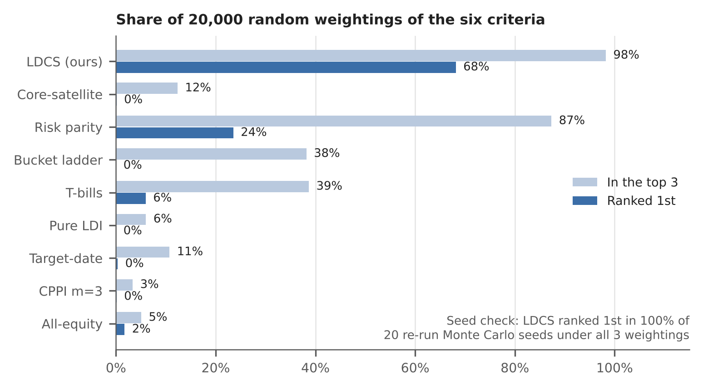
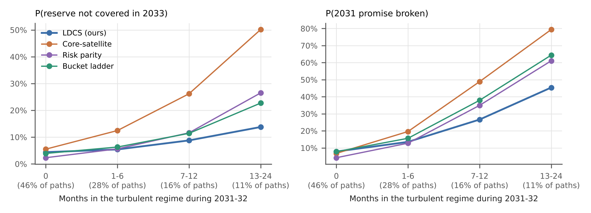

# Robustness of the strategy ranking

Generated by `src/robustness.py` from `results/strategy_results.json` and `results/crash_events.json`. **LDCS** in this page is S10C: hold Treasury, TIPS and T-bill funds worth the present value of Laura's ten payments; invest only the amount above that floor in equities, capped at 39.7%; reset each January and after any 20% fall in the equity sleeve; from the 2031 co-sponsor announcement add the announced minimum to the floor if two-year Treasury yields are at least 4% (modelled path by path; section I). S9A and S10 (earlier versions of the same rule) are left out of the ranking; S9 is the same ETFs held static, i.e. core-satellite without the floor rule.

## A. Scoreboard (Research Pack Table 8.21, nine strategies)

| Criterion | Definition |
|---|---|
| Minimum funding certainty | Lowest chance, across the four cases, that the 2033 portfolio covers the $421,767 reserve |
| Average funding certainty | Chance the 2033 portfolio covers the reserve, averaged over the four cases |
| Median contribution | Typical 2033 amount above the reserve (average of the history and current-yield cases) |
| Bad-case contribution (P5, J) | Amount above the reserve in the worst 5% of jump-diffusion paths |
| Crash resilience | Chance the reserve is still covered when each of six historical crashes is replayed to end in January 2033 |
| Promise reliability | How often the 2033 contribution meets the minimum announced to co-sponsors in 2031 (history, jumps, replays) |

| Strategy | Min. funding certainty | Avg. funding certainty | Median contribution | Bad-case P5 (J) | Crash resilience | Promise reliability | Avg rank equal / safety / growth |
|---|---|---|---|---|---|---|---|
| S10C LDCS (ours) | 83.5% (4) | 94.2% (2) | $187k (5) | -$7k (3) | 99.1% (2) | 89.0% (2) | 3.00 / 2.80 / 3.50 |
| S9 Core-satellite | 84.7% (2) | 93.3% (4) | $227k (4) | -$86k (7) | 89.8% (8) | 60.0% (7) | 5.33 / 5.30 / 5.00 |
| S7 Risk parity | 87.7% (1) | 95.1% (1) | $172k (7) | -$15k (5) | 98.6% (3) | 85.5% (4) | 3.50 / 3.00 / 4.38 |
| S0 Bucket ladder | 82.0% (5) | 93.5% (3) | $181k (6) | -$13k (4) | 98.4% (4) | 81.0% (5) | 4.50 / 4.40 / 4.88 |
| S1 T-bills | 24.6% (9) | 81.2% (9) | $110k (9) | $65k (1) | 100.0% (1) | 100.0% (1) | 5.00 / 5.00 / 6.00 |
| S2 Pure LDI | 56.1% (8) | 88.2% (7) | $125k (8) | $14k (2) | 98.2% (5) | 87.1% (3) | 5.50 / 5.60 / 6.12 |
| S6 Target-date | 84.6% (3) | 93.0% (5) | $238k (3) | -$95k (8) | 93.4% (7) | 74.8% (6) | 5.33 / 5.30 / 4.75 |
| S8 CPPI m=3 | 75.4% (7) | 86.2% (8) | $317k (2) | -$55k (6) | 94.2% (6) | 47.0% (9) | 6.33 / 6.80 / 5.25 |
| S4 All-equity | 76.8% (6) | 89.4% (6) | $422k (1) | -$228k (9) | 60.2% (9) | 47.7% (8) | 6.50 / 6.80 / 5.12 |

Order: **equal** S10C, S7, S0, S1, S9, S6, S2, S8, S4; **safety** S10C, S7, S0, S1, S9, S6, S2, S8, S4; **growth** S10C, S7, S6, S0, S9, S4, S8, S1, S2.

With all ten original strategies LDCS scores 4.00 / 3.80 / 4.75; the calendar glide path S9A scores 4.00 / 3.70 / 4.25. Leaving out our own two earlier versions is what turns that near-tie into a clear first place. (Research Pack Table 8.21, which locked in the promise in every path, is reproduced exactly: LDCS 4.00 / 3.80 / 4.75.)

## B. Random weights

| Strategy | P(ranked 1st) | P(top 3) |
|---|---|---|
| S10C LDCS (ours) | 68.2% | 98.2% |
| S9 Core-satellite | 0.1% | 12.4% |
| S7 Risk parity | 23.5% | 87.3% |
| S0 Bucket ladder | 0.0% | 38.2% |
| S1 T-bills | 6.0% | 38.7% |
| S2 Pure LDI | 0.0% | 6.0% |
| S6 Target-date | 0.4% | 10.7% |
| S8 CPPI m=3 | 0.1% | 3.4% |
| S4 All-equity | 1.7% | 5.1% |

20,000 weightings drawn from a flat Dirichlet distribution (every mix of the six criteria equally likely).

## C. Seed stability

| Strategy | equal: 1st in / place range | safety: 1st in / place range | growth: 1st in / place range |
|---|---|---|---|
| S10C LDCS (ours) | 100% / 1-1 | 100% / 1-1 | 100% / 1-1 |
| S9 Core-satellite | 0% / 5-5 | 0% / 5-5 | 0% / 4-5 |
| S7 Risk parity | 0% / 2-2 | 0% / 2-2 | 0% / 2-2 |
| S0 Bucket ladder | 0% / 3-3 | 0% / 3-3 | 0% / 4-5 |
| S1 T-bills | 0% / 4-4 | 0% / 4-4 | 0% / 8-8 |
| S2 Pure LDI | 0% / 7-7 | 0% / 7-7 | 0% / 9-9 |
| S6 Target-date | 0% / 6-6 | 0% / 6-6 | 0% / 3-3 |
| S8 CPPI m=3 | 0% / 8-8 | 0% / 8-8 | 0% / 7-7 |
| S4 All-equity | 0% / 9-9 | 0% / 9-9 | 0% / 6-6 |

The whole Monte Carlo (four cases and six crash replays, 10,000 paths each) was re-run on 20 fresh seeds. The base seed was also re-run through the same code and reproduces the scoreboard to 0.0e+00.

| Strategy | Minimum funding certainty (mean ± sd) | Average funding certainty (mean ± sd) | Median contribution (mean ± sd) | Bad-case contribution (P5, J) (mean ± sd) | Crash resilience (mean ± sd) | Promise reliability (mean ± sd) |
|---|---|---|---|---|---|---|
| S10C LDCS (ours) | 83.5% ± 0.38 | 94.3% ± 0.10 | $186k ± 0.8k | -$5k ± 1.0k | 99.2% ± 0.04 | 89.2% ± 0.07 |
| S9 Core-satellite | 85.4% ± 0.25 | 93.4% ± 0.11 | $227k ± 1.0k | -$82k ± 1.9k | 90.0% ± 0.18 | 60.0% ± 0.12 |
| S7 Risk parity | 87.7% ± 0.22 | 95.2% ± 0.06 | $172k ± 0.6k | -$12k ± 1.5k | 98.7% ± 0.05 | 85.6% ± 0.11 |
| S0 Bucket ladder | 81.7% ± 0.40 | 93.5% ± 0.13 | $180k ± 0.9k | -$11k ± 1.3k | 98.6% ± 0.05 | 81.0% ± 0.13 |
| S1 T-bills | 25.1% ± 0.48 | 81.3% ± 0.12 | $110k ± 0.2k | $65k ± 0.1k | 100.0% ± 0.00 | 100.0% ± 0.00 |
| S2 Pure LDI | 56.4% ± 0.44 | 88.4% ± 0.12 | $126k ± 0.5k | $14k ± 1.0k | 98.1% ± 0.05 | 87.2% ± 0.07 |
| S6 Target-date | 85.0% ± 0.24 | 93.1% ± 0.09 | $238k ± 0.9k | -$90k ± 2.2k | 93.5% ± 0.15 | 74.8% ± 0.17 |
| S8 CPPI m=3 | 75.2% ± 0.33 | 86.3% ± 0.12 | $319k ± 2.9k | -$53k ± 1.0k | 94.3% ± 0.10 | 47.0% ± 0.15 |
| S4 All-equity | 77.6% ± 0.33 | 89.5% ± 0.17 | $419k ± 3.3k | -$225k ± 3.0k | 60.0% ± 0.20 | 47.7% ± 0.13 |

## D. Paired tests against LDCS (same 10,000 paths, base seed)

| Rival | Funding: LDCS better / worse (of 4 cases) | Promise: better / worse | Contribution: LDCS higher / lower |
|---|---|---|---|
| S9 Core-satellite | 3 / 1 | 3 / 1 | 0 / 4 |
| S7 Risk parity | 1 / 2 | 1 / 2 | 4 / 0 |
| S0 Bucket ladder | 2 / 0 | 4 / 0 | 4 / 0 |
| S1 T-bills | 1 / 2 | 1 / 3 | 4 / 0 |
| S2 Pure LDI | 2 / 1 | 2 / 0 | 4 / 0 |
| S6 Target-date | 3 / 1 | 3 / 1 | 0 / 4 |
| S8 CPPI m=3 | 4 / 0 | 3 / 1 | 0 / 4 |
| S4 All-equity | 3 / 1 | 3 / 1 | 0 / 4 |

Funding and promise use McNemar's exact test on the paths where exactly one of the two strategies succeeds; the contribution uses the paired mean difference ± 1.96 standard errors. Full detail: `results/tables/paired_tests.csv`.

## E. Joint Poisson shortfall in 2031-32

| Crash type | Events / years | λ (90% range) | P(in 2031-32) | LDCS (ours) | Core-satellite | Bucket ladder | Risk parity | T-bills | Pure LDI | Target-date |
|---|---|---|---|---|---|---|---|---|---|---|
| 2008-type recession | 1 / 100 | 0.010 (0.001-0.047) | 2.0% | 93% | 5% | 74% | 85% | 100% | 100% | 41% |
| 2020-type V-shock | 3 / 100 | 0.030 (0.008-0.077) | 5.8% | 97% | 86% | 95% | 96% | 100% | 97% | 91% |
| 2022-type inflation | 2 / 100 | 0.020 (0.004-0.063) | 3.9% | 45% | 46% | 28% | 35% | 100% | 24% | 58% |
| 1973-74-type inflation | 2 / 100 | 0.020 (0.004-0.063) | 3.9% | 97% | 8% | 75% | 89% | 100% | 100% | 50% |
| 2000-02-type bust | 2 / 100 | 0.020 (0.004-0.063) | 3.9% | 100% | 65% | 100% | 100% | 100% | 100% | 86% |
| 2019-20 falling rates | 9 / 72 | 0.126 (0.066-0.219) | 22.2% | 100% | 100% | 100% | 100% | 100% | 100% | 100% |

Strategy columns: share of paths keeping the 2031 promise when the crash is replayed to end in January 2033.

| Strategy | Reserve shortfall: sum (union) [λ range] | Broken promise: sum (union) [λ range] |
|---|---|---|
| S10C LDCS (ours) | 0.21% (0.21%) [0.04%-0.62%] | 2.57% (2.56%) [0.46%-7.91%] |
| S9 Core-satellite | 2.04% (2.02%) [0.34%-6.69%] | 9.81% (9.45%) [1.62%-32.00%] |
| S7 Risk parity | 0.30% (0.30%) [0.05%-0.93%] | 3.54% (3.51%) [0.63%-11.01%] |
| S0 Bucket ladder | 0.37% (0.37%) [0.07%-1.12%] | 4.60% (4.54%) [0.80%-14.52%] |
| S1 T-bills | 0.00% (0.00%) [0.00%-0.00%] | 0.00% (0.00%) [0.00%-0.00%] |
| S2 Pure LDI | 0.43% (0.43%) [0.08%-1.29%] | 3.15% (3.15%) [0.59%-9.41%] |
| S6 Target-date | 1.45% (1.44%) [0.28%-4.53%] | 5.90% (5.77%) [1.00%-19.19%] |
| S8 CPPI m=3 | 1.60% (1.60%) [0.40%-4.41%] | 13.71% (12.98%) [2.61%-42.53%] |
| S4 All-equity | 8.45% (8.18%) [1.52%-26.85%] | 13.69% (12.98%) [2.52%-42.94%] |

Sum = Σ P(type occurs in 2031-32) × P(failure | worst-timed replay), an upper bound; union = 1 − Π(1 − each term), treating types as independent; the bracket uses each λ's 90% Garwood interval.

## F. Are crashes Poisson?

- By year: index of dispersion 0.91, p(overdispersed) = 0.73.
- By decade (counts [1, 0, 1, 1, 2, 0, 1, 1, 1, 2]): index 0.44, p = 0.91.
- Gaps between crashes (9, mean 10.3 years) against an exponential with mean 1/λ: KS = 0.28, p = 0.42.
None rejects a constant-rate Poisson at the 5% level. Ten events give these tests little power, which is why the Markov layer is kept as the clustering alternative.

## G. Markov regimes and conditional shortfall

Monthly transition matrix (calm, turbulent): [[0.975, 0.025], [0.123, 0.877]]; long-run shares 83.4% calm / 16.6% turbulent; expected spells 41 and 8.1 months. Starting from today's 1.8% turbulent probability, the chance of at least one turbulent month in 2031-32 is 52.9% (matrix powers) against 53.7% in the simulated paths.

| Turbulent months in 2031-32 | Share of paths | LDCS (ours): shortfall / broken | Core-satellite: shortfall / broken | Bucket ladder: shortfall / broken | Risk parity: shortfall / broken | Pure LDI: shortfall / broken |
|---|---|---|---|---|---|---|
| 0 | 46.3% | 4.4% / 7.9% | 5.5% / 6.8% | 3.9% / 7.8% | 2.3% / 4.3% | 1.7% / 12.7% |
| 1-6 | 27.6% | 5.4% / 13.5% | 12.4% / 19.6% | 6.3% / 15.6% | 5.6% / 12.8% | 2.4% / 14.9% |
| 7-12 | 15.5% | 8.8% / 26.6% | 26.2% / 48.9% | 11.4% / 37.9% | 11.6% / 34.9% | 3.2% / 18.9% |
| 13-24 | 10.5% | 13.8% / 45.4% | 50.1% / 79.4% | 22.7% / 64.4% | 26.5% / 61.1% | 5.0% / 24.8% |

Case J paths, base seed. Total shortfall = Σ share × conditional shortfall (checked in verify.py).

## H. Which crash hurts Laura most, and under which strategy

For each crash type we combine its Poisson probability of occurring in 2031-32 with what it does to each strategy when replayed to end at the January 2033 valuation. Cell = P(crash occurs in 2031-32 **and** breaks the 2031 promise), in %; the bold cell in each row is the strategy hit hardest among the seven compared in the Final Report.

| Crash type | λ a year | P(in 2031-32) | LDCS (ours) | Bucket ladder | T-bills | Pure LDI | Target-date | Risk parity | Core-satellite | Worst of all nine |
|---|---|---|---|---|---|---|---|---|---|---|
| 2008-type recession | 0.010 | 2.0% | 0.15% | 0.52% | 0.00% | 0.00% | 1.16% | 0.30% | **1.87%** | All-equity (1.97%) |
| 2020-type V-shock | 0.030 | 5.8% | 0.15% | 0.31% | 0.00% | 0.18% | 0.51% | 0.25% | **0.80%** | CPPI m=3 (1.91%) |
| 2022-type inflation | 0.020 | 3.9% | 2.16% | 2.81% | 0.00% | **2.97%** | 1.65% | 2.55% | 2.12% | Pure LDI (2.97%) |
| 1973-74-type inflation | 0.020 | 3.9% | 0.12% | 0.96% | 0.00% | 0.00% | 1.95% | 0.44% | **3.60%** | All-equity (3.91%) |
| 2000-02-type bust | 0.020 | 3.9% | 0.00% | 0.00% | 0.00% | 0.00% | 0.53% | 0.00% | **1.37%** | All-equity (3.91%) |
| 2019-20 falling rates | 0.126 | 22.2% | 0.00% | 0.01% | 0.00% | 0.00% | **0.09%** | 0.00% | 0.04% | CPPI m=3 (0.52%) |
| **All six types (sum)** |  |  | **2.57%** | **4.60%** | **0.00%** | **3.15%** | **5.90%** | **3.54%** | **9.81%** | CPPI m=3 (13.71%) |

Dollar view: fall in the median 2033 contribution when the crash is replayed, against the no-crash history case, and the Poisson-weighted expected fall Σ P(type) × fall over the five stock-crash types. A negative figure is a gain. The falling-rate replay raises every bond-holding strategy's contribution because the reserve is valued at a fixed 4%; at market yields the same fall in rates would also raise the cost of the ten payments, so we leave it out of the total.

| Crash type | LDCS (ours) | Bucket ladder | T-bills | Pure LDI | Target-date | Risk parity | Core-satellite |
|---|---|---|---|---|---|---|---|
| 2008-type recession | $44k | $72k | $1k | -$38k | $124k | $48k | $158k |
| 2020-type V-shock | $13k | $24k | $0k | -$13k | $37k | $14k | $51k |
| 2022-type inflation | $80k | $92k | $3k | $52k | $107k | $80k | $117k |
| 1973-74-type inflation | $44k | $72k | -$51k | -$29k | $115k | $48k | $147k |
| 2000-02-type bust | $3k | $20k | -$17k | -$92k | $83k | -$3k | $109k |
| 2019-20 falling rates | -$50k | -$46k | $1k | -$42k | -$58k | -$48k | -$54k |
| **Expected fall from the five stock-crash types, 2031-32** | **$7k** | **$10k** | **-$2k** | **-$4k** | **$16k** | **$7k** | **$21k** |

Strategies most exposed overall (sum of joint broken-promise probabilities, all nine): CPPI m=3 13.71%, All-equity 13.69%, Core-satellite 9.81%, Target-date 5.90%, Bucket ladder 4.60%, Risk parity 3.54%, Pure LDI 3.15%, LDCS (ours) 2.57%, T-bills 0.00%. Full table, including CPPI and all-equity and the reserve-shortfall version: `results/tables/crash_impact_by_strategy.csv`.

## I. Consistency with the IPS: tolerance band and the 2031 yield condition

The IPS commits to a cushion rule with a ±2% tolerance band; the Research Pack added the 2031 lock-in with a 2-year-yield condition and a 20% extra review. Each version of LDCS below is put into the same nine-strategy scoreboard in place of S10C.

| Version | Lock-in applied (share of paths) | Minimum funding certainty | Average funding certainty | Median contribution | Bad-case contribution | Crash resilience | Promise reliability | Place equal / safety / growth |
|---|---|---|---|---|---|---|---|---|
| LDCS without the yield condition (lock-in in every path), as in the Research Pack | 100% | 83.0% (4) | 94.1% (2) | $184k (5) | -$6k (3) | 99.2% (2) | 91.2% (2) | 1 / 1 / 1 |
| LDCS as defined: lock-in only if the 2-year yield is at least 4% (the headline in this page) | 68% | 83.5% (4) | 94.2% (2) | $187k (5) | -$7k (3) | 99.1% (2) | 89.0% (2) | 1 / 1 / 1 |
| LDCS with the IPS ±2% tolerance band checked monthly, no 20% trigger | 68% | 82.1% (4) | 93.8% (2) | $185k (5) | -$7k (3) | 99.2% (2) | 89.6% (2) | 1 / 1 / 1 |
| LDCS with the IPS ±2% band and the 20% trigger | 68% | 82.3% (4) | 93.9% (2) | $185k (5) | -$7k (3) | 99.2% (2) | 89.6% (2) | 1 / 1 / 1 |
| IPS cushion rule only (no 2031 lock-in), ±2% band | none (no lock-in) | 83.1% (4) | 94.0% (2) | $194k (5) | -$8k (3) | 99.1% (2) | 85.5% (3) | 1 / 1 / 1 |

The 2-year yield in January 2031 is the simulated 5-year yield minus today's 0.08-point 5y-2y spread (the engine tracks the 5-year yield only).

## Limits of these tests

- Seed stability measures Monte Carlo sampling noise only. Every seed resamples the same 2004-2026 history, uses the same six crash replays and the same model, so it says nothing about model risk; the four cases (H, S, C, J) and the λ ranges are the model-risk checks.
- The six criteria and the three weightings are team judgements. Random weights test the weights, not the choice of criteria.
- With 10,000 paths the paired tests detect very small differences. Statistically significant is not the same as large enough to matter to Laura.
- Crash replays are deterministic worst-timing stresses. The joint Poisson figures are upper bounds and the union form assumes crash types are independent.
- The simulation ends in January 2033; the payout years 2033-42 are not simulated.
- S0 is one bucket design (a liability ladder refilled only after up years). Other bucket designs could rank differently.
- The 2031 yield condition uses the 2-year yield estimated from the simulated 5-year yield and today's 0.08-point spread.
- In the 1973-74 replay TIPS are a CPI-plus-1% stand-in that gains 21% over the episode; real TIPS would also have lost value as real yields rose, so that row flatters every strategy holding SCHP, LDCS included.
- The falling-rate (T5) replay raises contributions because the reserve is valued at a fixed 4%; at market yields the payments would also cost more, so section H leaves T5 out of the dollar total.

## Figures

